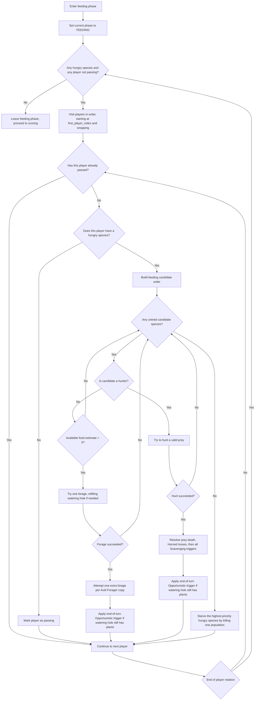
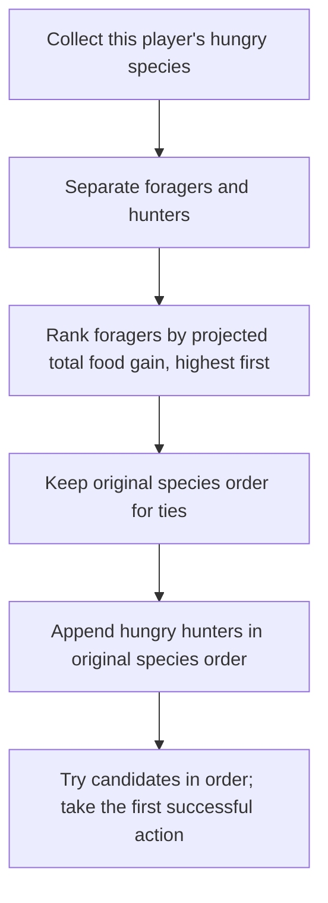
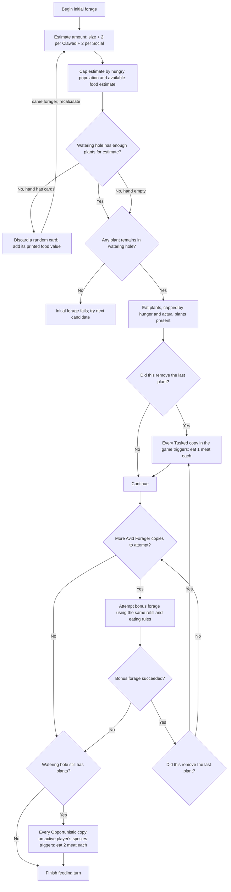
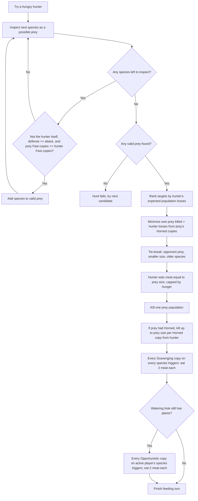

# Feeding Phase Flow and Decisions

This chart documents the plant-and-meat feeding behavior implemented by the solo engine, including the Promo Avid Forager trait. Bamboo Grove is configurable elsewhere in the engine, but `FeedingRules` does not yet resolve bamboo food or its module-specific feeding effects; those rules are outside this chart.

## Image files

- [Phase and turn flow (PNG)](./docs/images/feeding-phase/phase-and-turn-flow.png) | [SVG](./docs/images/feeding-phase/phase-and-turn-flow.svg)
- [Feeding candidate order (PNG)](./docs/images/feeding-phase/feeding-candidate-order.png) | [SVG](./docs/images/feeding-phase/feeding-candidate-order.svg)
- [Forage and plant-food resolution (PNG)](./docs/images/feeding-phase/forage-and-plant-food.png) | [SVG](./docs/images/feeding-phase/forage-and-plant-food.svg)
- [Hunt and prey selection (PNG)](./docs/images/feeding-phase/hunt-and-prey-selection.png) | [SVG](./docs/images/feeding-phase/hunt-and-prey-selection.svg)

## Phase and turn flow

The engine repeats complete player rotations while any species is hungry and at least one player has not passed. A player with no hungry species passes when their turn is reached. A player who still has hungry species but cannot complete a feeding action starves one population instead of passing.

The candidate order is built once, before the turn's first discard. Refilling does not recalculate that order: the selected forager continues its forage attempt. The implementation can move to the next candidate if an attempt returns failure, but with the normal Nature deck's positive food values (1–4), a refill begun with cards produces at least one plant and that initial forage succeeds.

## Feeding candidate order

Forager projections simulate the base forage and each Avid Forager bonus forage, refills, Tusked triggers, and the player's Opportunistic triggers. The estimate values each card in hand at three plants. During an actual refill, a random card is discarded and its printed food value is added to the watering hole. Hunters are considered only after all foragers, regardless of how much food a hunt might provide.

## Forage and plant-food resolution

The `E --> B` loop recalculates the capped amount for the same already-selected forager; it does not choose another species. All eating effects are capped by the species' hungry population. Each Social copy adds two food from the same source as the triggering food; each Clawed copy adds two only when eating plants. If a refill leaves no plants after the hand is exhausted, that forage attempt fails. Avid Forager stops at its first failed bonus forage.

Tusked triggers for every species belonging to either player, once per copy, whenever removing plants changes the watering hole from nonempty to empty. A refill can make it trigger again later in the same round.

## Hunt and prey selection

Attack and defense values start at species size. Clawed adds two attack and one defense per copy; Opportunistic adds one defense; Plated adds four defense; Tusked adds two defense. Each Horned copy causes hunter losses equal to prey size, capped by the hunter's current population. These losses are included in prey ranking and applied after the prey is killed.

When a population is killed, its owner is credited with the loss. If the species was fully fed just before the loss, one food is removed (plant food first, otherwise meat). Killing its last population removes the species, banks its size, and returns its trait cards according to the extinction rules.

## Starvation fallback

When no candidate can feed, one population is killed from the first available group:

1. Hungry hunters, in species order.
2. Foragers with no food at all, lowest population first and then oldest first.
3. Other hungry foragers, in species order.

The same population-loss and extinction handling used for a hunt applies. Feeding ends once no species is hungry, or the engine's turn loop has no non-passing players left. The following scoring phase counts remaining food, clears it from species, and applies end-of-round population-loss effects.
