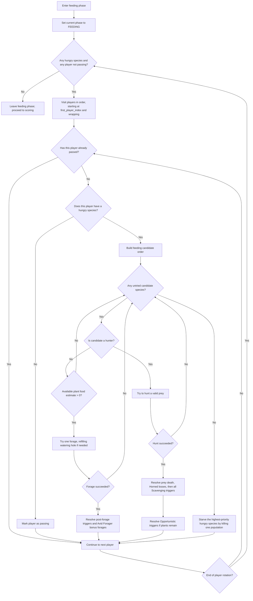
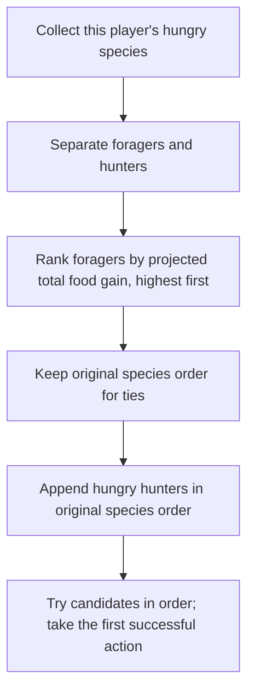
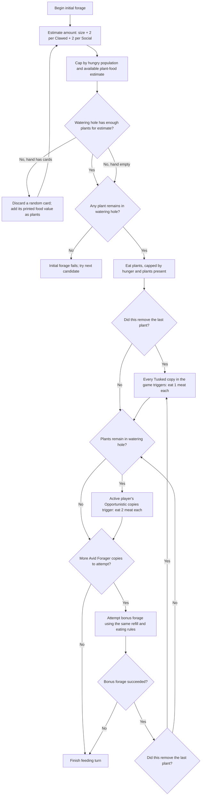
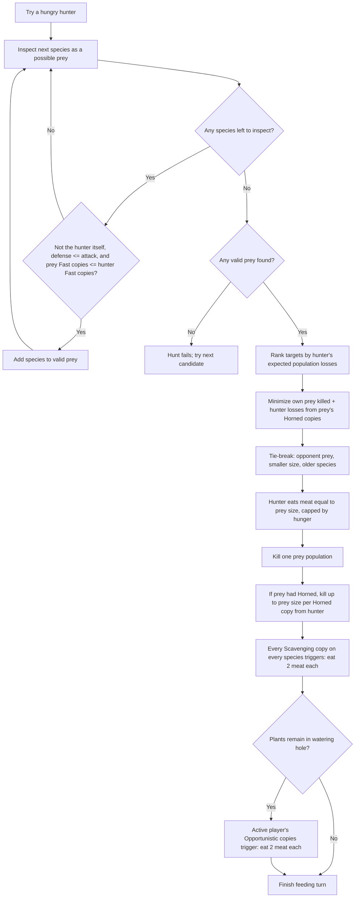
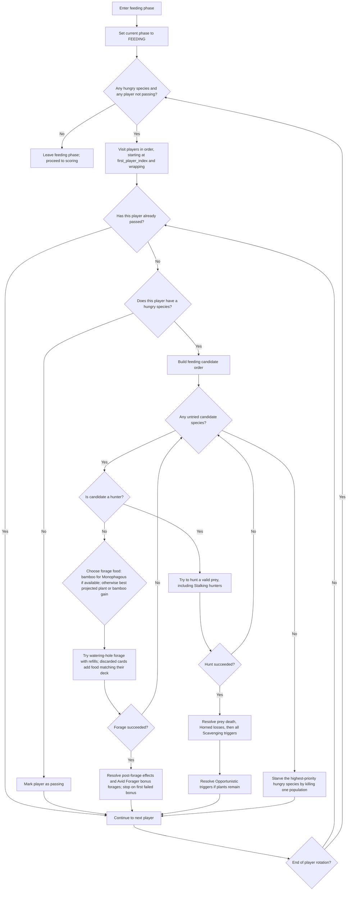
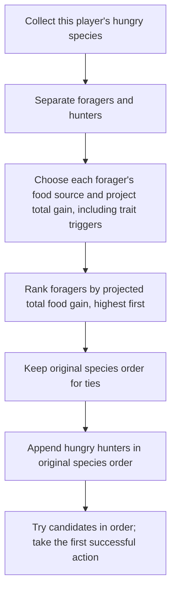
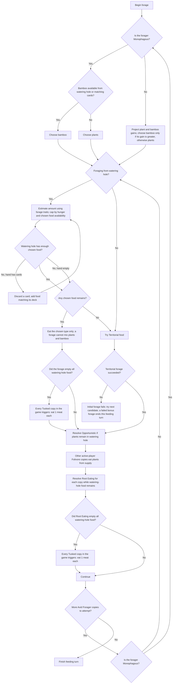
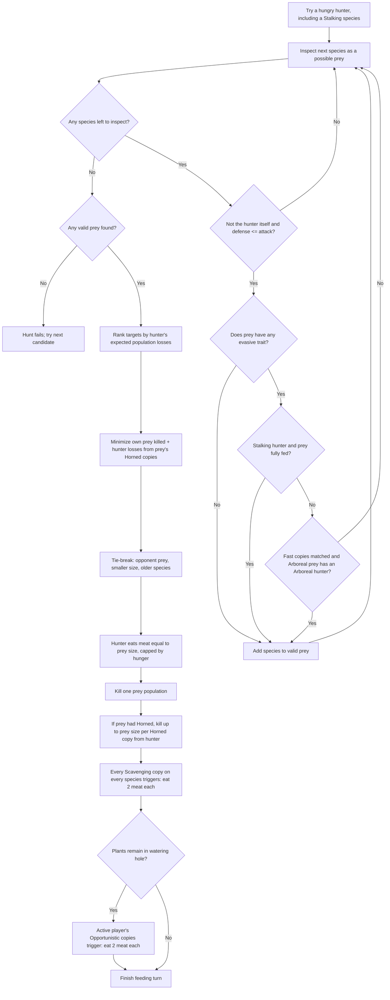

# Feeding Phase Flowcharts

The diagrams below document the solo engine's feeding behavior in two configurations: core Nature, and games that include Bamboo Grove. Each set has its own phase flow, candidate order, forage resolution, and hunt/prey selection.

## Core Nature

### Phase and turn flow

### Feeding candidate order

### Forage and plant-food resolution

### Hunt and prey selection

Foragers are ordered once at the start of the player's turn by projected total food gain, with original species order breaking ties; hunters follow in species order. Refilling does not rebuild that order or change the selected forager. Each successful forage resolves Opportunistic effects before the next Avid Forager attempt. Projections value each card in hand at three plants; an actual refill adds the discarded card's printed food value.

The forage amount is capped by hunger and available plants. Clawed adds two plants per copy and Social adds two food from the source per copy. Tusked triggers for every species belonging to either player, once per copy, when the last plant leaves the watering hole. Refilling can empty the watering hole again later in the round.

Attack and defense start at species size. Clawed adds two attack and one defense per copy; Opportunistic adds one defense; Plated adds four defense; Tusked adds two defense. Each Horned copy causes hunter losses equal to prey size, capped by the hunter's current population. These losses are included in prey ranking and applied after the prey is killed.

When no candidate can feed, one population is killed from the first available group:

1. Hungry hunters, in species order.
2. Foragers with no food at all, lowest population first and then oldest first.
3. Other hungry foragers, in species order.

The same population-loss and extinction handling used for a hunt applies. Feeding ends once no species is hungry, or the engine's turn loop has no non-passing players left. Scoring then counts remaining food, clears it from species, and applies end-of-round population-loss effects.

## Games with Bamboo Grove

### Phase and turn flow

### Feeding candidate order

### Forage and plant-or-bamboo resolution

### Hunt and prey selection

In Bamboo Grove, a forage takes either plants or bamboo, never a mix. Monophagous selects bamboo when the watering-hole estimate includes bamboo (including potential Bamboo Grove card refills), and otherwise selects plants. If that forage cannot feed, the Territorial fallback checks bamboo first for Monophagous. Other foragers choose bamboo only when its projected gain is greater than the plant gain; ties favor plants. Avid Forager repeats the same food choice, with Monophagous rechecking its availability for each bonus forage.

The forage amount is capped by hunger and food at the selected source. Social adds two food per copy; Arboreal adds one food per copy from either forage type; Clawed adds two only when foraging for plants. Refills add the discarded card's printed value to the food type associated with that card's deck. Tusked triggers whenever a watering-hole food removal empties the entire supply, including ordinary foraging and Root Eating; a later refill and emptying triggers it again. After any successful forage, Opportunistic triggers if plants remain in the watering hole, Folivore triggers on the active player's other species, and then Root Eating resolves. Territorial food can be used as a fallback forage source.

Stalking makes a species a hunter. It can bypass evasive traits when the prey is fully fed; otherwise Fast must still be matched, and Arboreal prey still require an Arboreal hunter. A hunter that eats prey with Horned loses population as shown in the shared hunt flow. Scavenging and Opportunistic resolve after a successful hunt as shown above.

As in core Nature, candidates are ranked once per turn by projected gain and starvation removes one population using the same priority order. The Bamboo Grove forage projection also accounts for food-type availability, card decks, Territorial food, and module trait triggers.
